# Infrastructure as Code with GitHub Actions + AWS CloudFormation (OIDC)

A `git push` to `main` deploys AWS infrastructure. GitHub Actions validates a CloudFormation template and creates or updates the stack. It authenticates to AWS with **OpenID Connect (OIDC)** short-lived credentials, so no access keys are stored anywhere. The stack provisions a VPC, a public subnet, routing, a security group, and an **Ubuntu 24.04 EC2** instance that installs and serves **Nginx** through User Data.

|                                     |                                                                                                                          |
| ----------------------------------- | ------------------------------------------------------------------------------------------------------------------------ |
| **Repository**                      | https://github.com/abuabddullah/bongodev-cloudformation-github-actions                                                   |
| **Second-push commit (tag update)** | `https://github.com/abuabddullah/bongodev-cloudformation-github-actions/commit/8c3c540ad724e950616680d5e470f55d39a036ee` |
| **AWS Region**                      | `us-east-1` (N. Virginia)                                                                                                |
| **Stack**                           | `bongodev-github-iac-dev`                                                                                                |
| **Status**                          | ✅ Deployed, updated through Git, verified, and cleaned up                                                               |

> The assignment's original instructions are in [`docs/assignment-instructions.md`](docs/assignment-instructions.md).

---

## Architecture

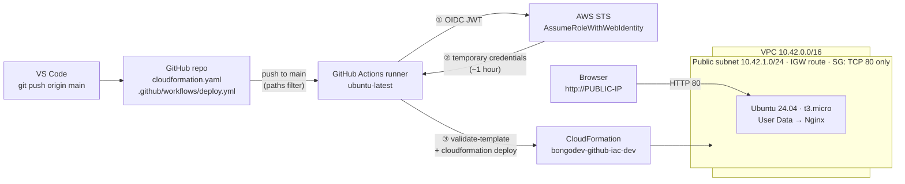

**Flow**

1. I push a change to `cloudformation.yaml` or `deploy.yml` on `main`.
2. The workflow starts. It has `permissions: id-token: write`, so GitHub issues it a signed **OIDC token (JWT)**.
3. `aws-actions/configure-aws-credentials` sends the token to **AWS STS**. AWS checks three things: the signature (through the IAM OIDC identity provider), the audience (`aud = sts.amazonaws.com`), and the subject (`sub` = exactly this repository's `main` branch). It then returns **temporary credentials**.
4. The runner runs `aws cloudformation validate-template`, then `aws cloudformation deploy`. The deploy command **creates** the stack the first time and **updates** it with a change set after that.
5. CloudFormation builds the network and the EC2 instance. On first boot, User Data runs `apt-get install nginx` and writes the demo page.

---

## AWS Resources

### Created once by me (IAM, in the console)

| Resource                    | Name                                                                 | Purpose                                                                   |
| --------------------------- | -------------------------------------------------------------------- | ------------------------------------------------------------------------- |
| IAM OIDC identity provider  | `token.actions.githubusercontent.com` (audience `sts.amazonaws.com`) | Lets AWS verify tokens signed by GitHub Actions                           |
| IAM customer-managed policy | `bongodev-github-iac-lab-policy`                                     | CloudFormation deploy and read, SSM AMI lookup, EC2/VPC create and delete |
| IAM role                    | `bongodev-github-iac-deploy-role`                                    | Assumed by GitHub Actions through web identity                            |

### Created by CloudFormation (from the template, by GitHub Actions)

| Logical ID                                        | Type           | Notes                                                                       |
| ------------------------------------------------- | -------------- | --------------------------------------------------------------------------- |
| `DemoVPC`                                         | VPC            | `10.42.0.0/16`, DNS support and hostnames enabled                           |
| `PublicSubnet`                                    | Subnet         | `10.42.1.0/24`, auto-assign public IPv4                                     |
| `InternetGateway` + `GatewayAttachment`           | IGW            | Internet access                                                             |
| `PublicRouteTable` + `DefaultRoute` + association | Routing        | `0.0.0.0/0` → IGW                                                           |
| `WebSecurityGroup`                                | Security group | Inbound **TCP 80 only**. No SSH and no key pair.                            |
| `UbuntuNginxServer`                               | EC2            | Ubuntu 24.04 (Canonical SSM parameter AMI), `t3.micro`, **IMDSv2 required** |
| Outputs                                           | —              | `WebsiteURL`, `InstanceId`, `PublicIPAddress`, `VpcId`                      |

---

## Security: OIDC Trust Instead of Access Keys

The role's trust policy accepts **only** tokens from this repository's `main` branch. The repository was created after July 15, 2026, so GitHub uses the **immutable subject format** with numeric owner and repository IDs:

```json
{
  "Version": "2012-10-17",
  "Statement": [
    {
      "Effect": "Allow",
      "Principal": {
        "Federated": "arn:aws:iam::<AWS_ACCOUNT_ID>:oidc-provider/token.actions.githubusercontent.com"
      },
      "Action": "sts:AssumeRoleWithWebIdentity",
      "Condition": {
        "StringEquals": {
          "token.actions.githubusercontent.com:aud": "sts.amazonaws.com",
          "token.actions.githubusercontent.com:sub": "repo:abuabddullah@<OWNER_ID>/bongodev-cloudformation-github-actions@<REPO_ID>:ref:refs/heads/main"
        }
      }
    }
  ]
}
```

- **`StringEquals` with no wildcards:** no other repository, fork, or branch can assume the role.
- **Numeric IDs:** if the repository were renamed or deleted and someone recreated the same name, the IDs would not match, so they could not inherit the trust.
- **GitHub repository _variables_ (not secrets):** `AWS_ROLE_ARN` and `AWS_REGION` are configuration identifiers, not credentials. No `AWS_ACCESS_KEY_ID` or `AWS_SECRET_ACCESS_KEY` exists anywhere.
- **No `cloudformation:DeleteStack` and no `iam:*`** in the deployment policy. The pipeline can create and update the stack, but it cannot delete it or escalate its own privileges. I deleted the stack with my own console identity.
- **Lab limitation:** the EC2 actions use `Resource: "*"` for classroom simplicity. For production I would scope by resource or tag, use a CloudFormation service role, add environment approvals, and protect the `main` branch.

---

## Evidence

### 1. AWS IAM setup

OIDC identity provider:

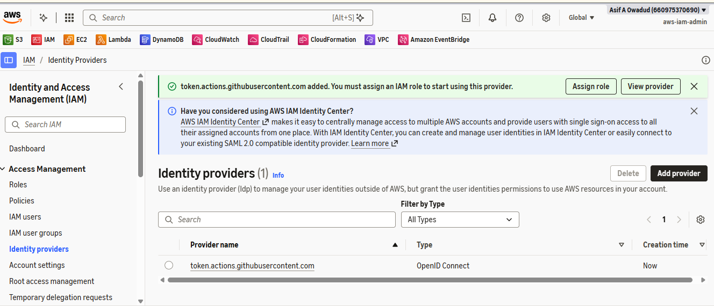

Role trust policy with the immutable `sub` (account ID redacted):

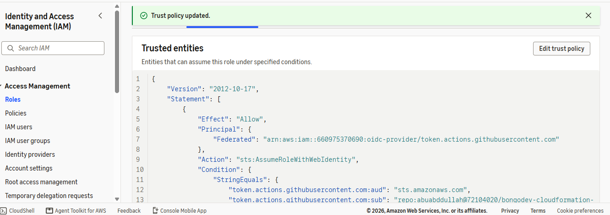

GitHub repository variables (Variables tab, not Secrets):

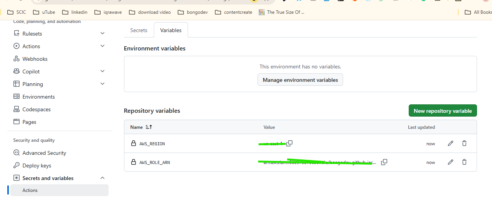

### 2. First push: automatic stack creation

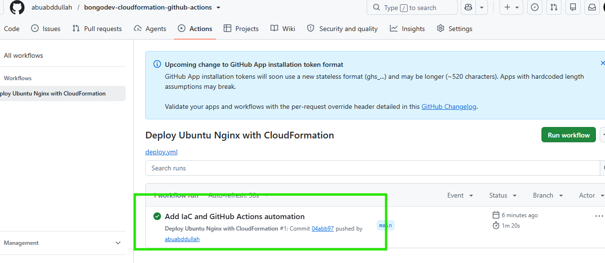

Workflow steps (checkout, OIDC credentials, identity, validate, deploy, outputs):

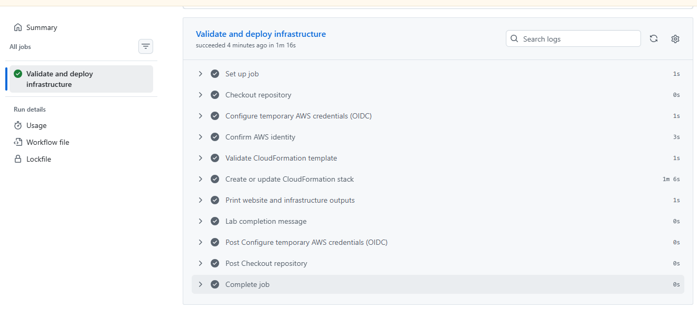

Stack `CREATE_COMPLETE`, with no manual "Create stack" in the console:

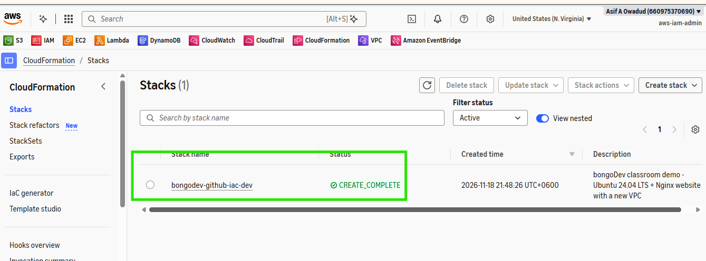

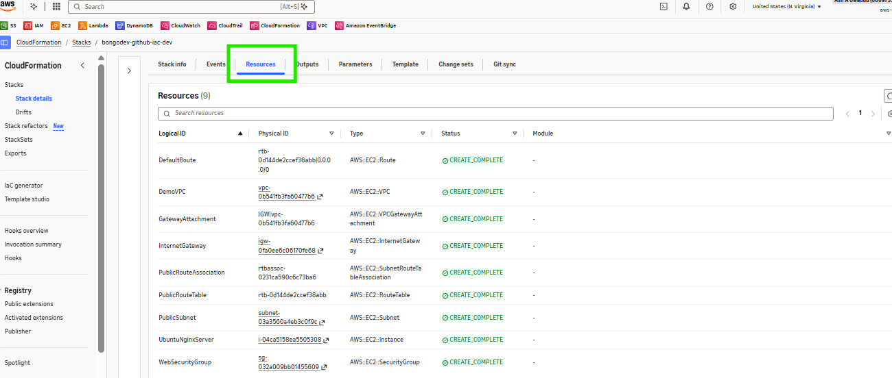

Live Nginx site served from the stack's EC2 instance:

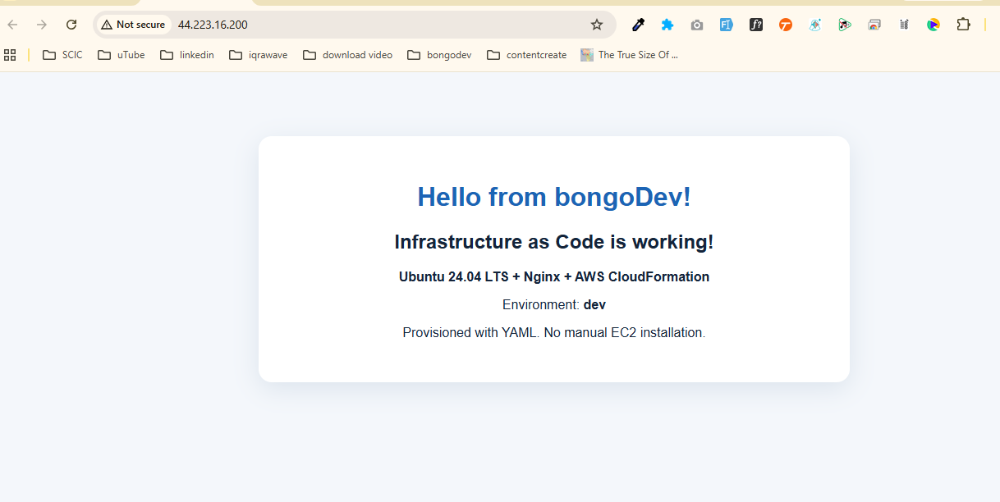

EC2 instance before the update (`Course = bongoDev-DevOps`):

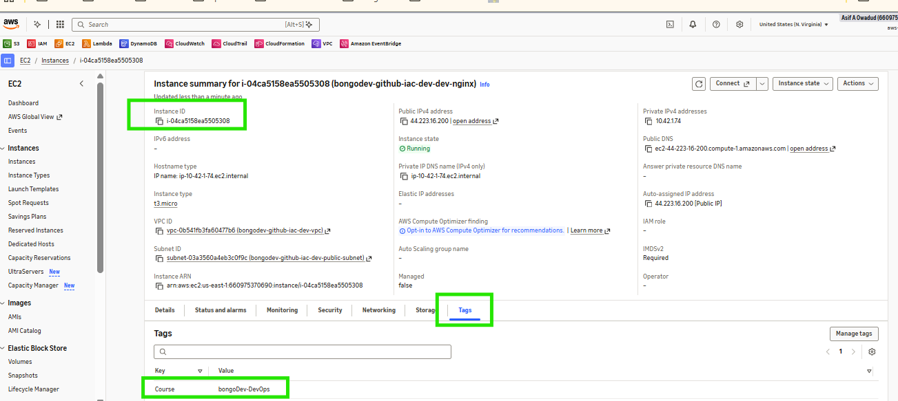

### 3. Second push: in-place stack update

In `cloudformation.yaml`, I changed only the EC2 tag:

```diff
         - Key: Course
-          Value: bongoDev-DevOps
+          Value: bongoDev-DevOps-Homework-V2
```

Commit: `https://github.com/abuabddullah/bongodev-cloudformation-github-actions/commit/8c3c540ad724e950616680d5e470f55d39a036ee`

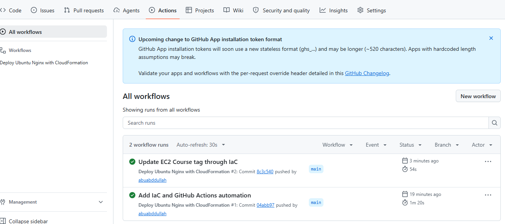

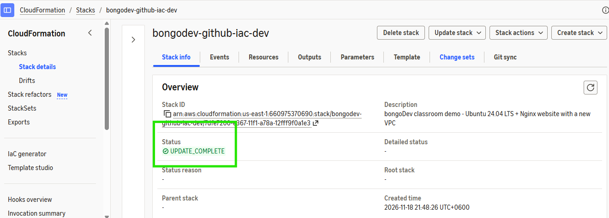

Same **Instance ID** with the new tag, which shows the instance was updated in place and not replaced:

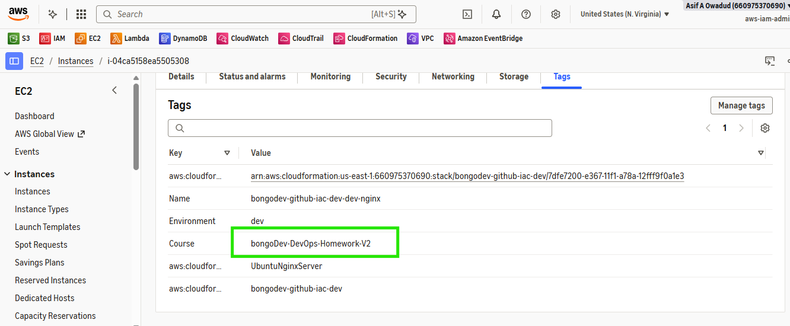

### 4. Cleanup

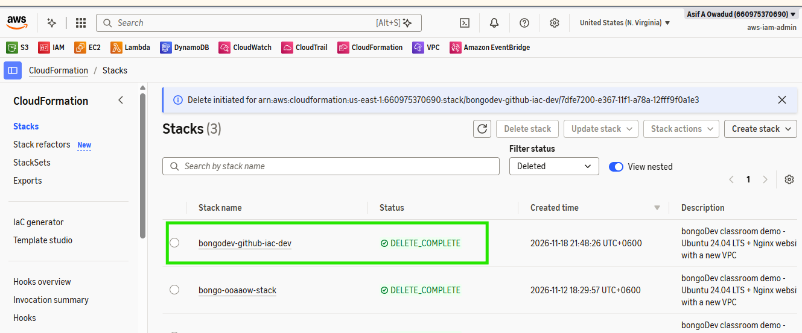

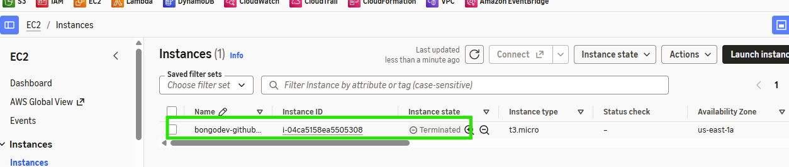

After the evidence was captured:

- I deleted stack `bongodev-github-iac-dev` from the CloudFormation console (`DELETE_COMPLETE`). The EC2 instance terminated, and the VPC and network resources were removed.
- I **disabled** the GitHub workflow so that later repository edits cannot recreate the stack.
- I deleted the lab IAM role and policy.

---

## GitHub Actions vs CloudFormation

**GitHub Actions** is the _automation engine_. It watches the repository and, on a push to `main`, runs a pipeline of steps on a temporary runner: checkout, get AWS credentials through OIDC, validate, deploy. **CloudFormation** is the _provisioning engine_. It reads the YAML description of the desired infrastructure and creates, updates, or deletes AWS resources in the right order until the account matches that description.

**OIDC is preferred over long-lived access keys** because nothing permanent is stored. Each run gets a token signed by GitHub and trades it for credentials that expire in about an hour. Those credentials are valid only for this repository's `main` branch. A stored access key works for anyone who obtains it until someone notices and rotates it.

---

## Answers to Homework Questions

**1. What is the difference between GitHub Actions and AWS CloudFormation?**
GitHub Actions is a CI/CD orchestrator. It decides _when_ something runs (on push, on manual dispatch) and _which commands_ run, on a GitHub-hosted runner. CloudFormation is an AWS Infrastructure-as-Code service. It decides _what_ AWS resources should exist and reconciles them with the template: it creates, updates, or replaces resources and rolls back on failure. In this lab, Actions _calls_ CloudFormation, and CloudFormation _does_ the provisioning.

**2. Why can a `git push` deploy infrastructure without anyone logging into the AWS console?**
The push triggers the workflow (`on: push: branches: [main]`, filtered to the template and workflow files). The workflow gets AWS credentials on its own through OIDC, because the IAM role trusts this repository, and then runs the AWS CLI (`validate-template`, `cloudformation deploy`). All the human decisions are already written in Git (the template) and in IAM (the trust and permissions), so no one needs to click anything in the console.

**3. What does OIDC do, and why is it safer than committing AWS access keys?**
OIDC lets GitHub prove the workflow's identity with a signed, short-lived token. The token states which repository, branch, and audience it belongs to. AWS verifies the signature with GitHub's public keys (through the IAM identity provider), checks `aud` and `sub` against the role's trust policy, and issues temporary STS credentials that expire in about an hour. There is no long-lived secret to leak, rotate, or accidentally commit, and the credentials cannot be used from any other repository or branch. Committed access keys are permanent, work from anywhere, are often scraped from public repositories within minutes, and stay valid until manually revoked.

**4. On a second push, why is the existing stack updated instead of creating a new one?**
`aws cloudformation deploy` uses a fixed stack name (`bongodev-github-iac-dev`). If no stack with that name exists, it creates one. If it exists, it builds a **change set**, which is the difference between the current stack and the new template, and executes it. A tag change is an in-place update, so the same EC2 instance (same Instance ID) is kept. Changing a property that requires replacement, such as `ImageId` or `InstanceType`, would create a new instance. `--no-fail-on-empty-changeset` makes a run with no changes succeed, so the pipeline is idempotent.

**5. Is CloudFormation stack creation complete always the same as Nginx ready? Why not?**
No. CloudFormation marks the EC2 resource complete once the instance is launched. User Data, which runs `apt-get update`, installs Nginx, and writes the page, runs _after_ boot and takes extra minutes. This template has no `cfn-signal` or `WaitCondition`, so CloudFormation does not wait for the bootstrap script. Right after `CREATE_COMPLETE` the site may time out for a short while until User Data finishes.

**6. Why does this homework update the EC2 tag instead of changing the webpage HTML?**
User Data runs only on the instance's **first boot**. If I edited the HTML inside User Data, CloudFormation would update the instance's user-data attribute, but the script would not run again on the running server, so the page would not change. That would look like a failed update even though the deployment worked. A tag change is an in-place, immediately visible change that clearly proves the push → update path. Real application changes should use an application deployment mechanism (SSM, CodeDeploy, an app pipeline) or deliberate instance replacement.

**7. What should happen to AWS resources when you have finished the assignment?**
They should be deleted to avoid charges and leftover attack surface. That means deleting the CloudFormation stack (which removes the EC2 instance, EBS volume, public IPv4, VPC, subnet, IGW, routes, and security group), confirming `DELETE_COMPLETE` and that the instance is terminated, disabling the workflow so a later push cannot recreate the stack, and deleting the lab IAM role and permissive policy when they are no longer needed. The OIDC provider can be kept only if another project uses it.

---

## Notes and Lessons Learned

- **Region:** the assignment text said "us-west-2 (N. Virginia)", but N. Virginia is `us-east-1`. The workflow reads the region from `vars.AWS_REGION`, so only the GitHub variable needed to be set to `us-east-1`.
- **The IAM "Web identity" wizard writes the old name-only subject** (`repo:owner/repo:...`). For a repository created after July 15, 2026, that never matches the token's immutable subject, so the trust policy must be replaced with the `owner@OWNER_ID/repo@REPO_ID` format.
- **Set up IAM and the repository variables _before_ the first push.** The first push includes `deploy.yml`, so it starts a deployment immediately.
- **The `paths` filter** means README or screenshot commits do not redeploy infrastructure. I also disabled the workflow after cleanup as an extra safeguard.

---

## Repository Structure

```
.
├── README.md                              # this submission report
├── cloudformation.yaml                    # VPC + subnet + IGW + SG + Ubuntu EC2 + Nginx
├── .github/workflows/deploy.yml           # validate + deploy on push to main (OIDC)
├── iam/
│   ├── deployment-policy-lab.json         # role permissions (sandbox only)
│   ├── trust-policy-new-repos-2026.json   # immutable-subject trust (used)
│   └── trust-policy-legacy-repos.json     # name-only subject (older repos)
├── docs/
│   ├── assignment-instructions.md         # original assignment README
│   ├── student-submission-checklist.md
│   └── screenshots/                       # 01–14, account details redacted
└── .gitignore
```

No AWS access keys, session tokens, account IDs, or private keys are committed. The account ID and role ARN are redacted in screenshots.
